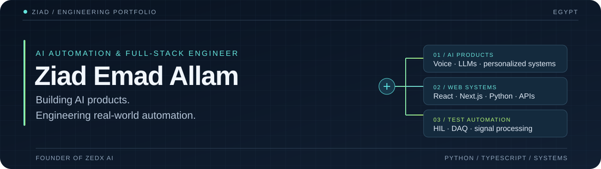

  

  <a href="https://zedx-ai.tech"><strong>ZEDX AI</strong></a> &nbsp; / &nbsp;
  <a href="https://www.linkedin.com/in/ziad-emad-allam-02153z">LinkedIn</a> &nbsp; / &nbsp;
  <a href="mailto:ziademadbts@gmail.com">Email</a> &nbsp; / &nbsp;
  <a href="assets/ziad-emad-allam-resume.pdf">Resume</a>

I build software that connects **AI, full-stack products, and real-world automation**. I'm a software engineer based in Egypt with 3+ years of experience, the founder and solo developer of **ZEDX AI**, and an R&D software engineer working on Python automation for embedded-firmware testing.

My work spans conversational AI, web applications, and hardware-in-the-loop systems: from a user's microphone to an interview report, and from a physical sensor to an automated diagnostic result.

### Impact

| Product reach | Industrial automation | Client delivery |
| :--- | :--- | :--- |
| **20,000+ ZEDX users** | **$70,000 annual tooling savings** | **10+ full-stack projects** |
| 490 premium subscribers · 2 B2B customers | Firmware test accuracy: 42% → 91% | 4.8/5 client satisfaction |

### Selected engineering

#### 01 / ZEDX AI — personalized interview practice

**Founder & solo developer** · [Live product](https://zedx-ai.tech) · [Repository](https://github.com/ziademad02153/ZEDX-AI-Simulator)

Interview practice in **30 languages**, tailored to a candidate's CV, target role, and job description. Follow-up questions respond to the candidate's answers; structured evaluations produce scorecards and PDF reports.

- Built the voice pipeline across voice activity detection, speech recognition, streamed LLM responses, and speech synthesis.
- Implemented provider failover, typed evaluation outputs, and personalized interview context.
- Applied database access controls and safeguards for untrusted resume content.

`Next.js` `React` `TypeScript` `Supabase` `Groq` `STT / TTS` `SSE`

#### 02 / BLDC motor testing — hardware-in-the-loop automation

[Repository](https://github.com/ziademad02153/Sharp-VE-BLDC--app-v2)

A Python test framework for inverter washing-machine firmware, connecting **8-channel, 10 kHz DAQ telemetry** with real-time analysis, oscilloscope views, and automated Excel diagnostics.

- Used finite state machines and signal processing to validate motor agitation and closed-loop RPM behavior.
- Implemented 12 industrial fault-tree protocols and replaced proprietary tooling, saving **$40,000/year**.

`Python` `PyQt` `nidaqmx` `NumPy` `SciPy` `asyncio`

#### 03 / Heater & microwave systems — automated diagnostics

[Water-heater repository](https://github.com/ziademad02153/local-automation-wh-iec-app) · [Microwave repository](https://github.com/ziademad02153/local-automation-Microwave-gril-app)

Migrated legacy LabVIEW test lines to Python, combining FFT-based analysis and predictive models with automated diagnostics. Reduced annual tooling costs by **$30,000** and increased test coverage from **40% to 86%**.

`Python` `PyQt6` `Pandas` `SciPy` `DAQ` `Docker`

### Engineering toolkit

| Area | Tools & methods |
| :--- | :--- |
| **Languages** | Python · TypeScript · JavaScript · SQL |
| **Web products** | React · Next.js · Tailwind CSS · Framer Motion |
| **Backend & APIs** | Node.js · Express · FastAPI · Flask · REST · WebSockets · JWT / RBAC |
| **AI systems** | LLM APIs · prompt engineering · STT / TTS pipelines · structured outputs |
| **Data & delivery** | PostgreSQL · Supabase · MySQL · SQLite · AWS · Docker · CI/CD |
| **Test automation** | HIL · DAQ · DSP / FFT · NumPy · SciPy · PyQt / PySide · state machines |

### Experience

**R&D Software Engineer · Elaraby Group**  
June 2024 – Present

Built Python HIL test harnesses and DAQ pipelines across washing-machine, water-heater, and microwave product lines. Replaced proprietary and LabVIEW tooling, and integrated Dassault 3DEXPERIENCE for automated defect reporting.

**Full-Stack Developer · Freelance / Upwork**  
November 2022 – November 2025

Delivered MERN applications for international clients. Built analytics dashboards that improved engagement by 15% and CI/CD pipelines that reduced manual deployment time by 70%.

<strong>Education, certifications & languages</strong>

#### Education

- **B.Sc. Computer and Information Systems — HICMIT, Tanta**  
  October 2023 – June 2027 (expected) · GPA 3.5
- **Data Analysis & Visualization — The American University in Cairo**  
  May 2025 – January 2026 · CDAV101 final grade: A
- **GCI World Data Science — University of Tokyo, Matsuo-Iwasawa Laboratory**  
  April – August 2026 · Passed final assessment

#### Selected credentials

- Oracle Cloud Infrastructure 2025 Certified Generative AI Professional
- DataCamp Certified Python Data Associate
- micro1 Certified Software Engineer
- Microsoft course completion certificates covering Azure OpenAI, Semantic Kernel agents, Azure services, Microsoft Graph, and TypeScript

**Languages:** Arabic (native) · English (C1)

### GitHub achievements

  
  &nbsp;
  

[View achievement details](https://github.com/ziademad02153?tab=achievements)

---

**Let's build something useful.**  
For AI products, full-stack engineering, or test automation: [ziademadbts@gmail.com](mailto:ziademadbts@gmail.com)
